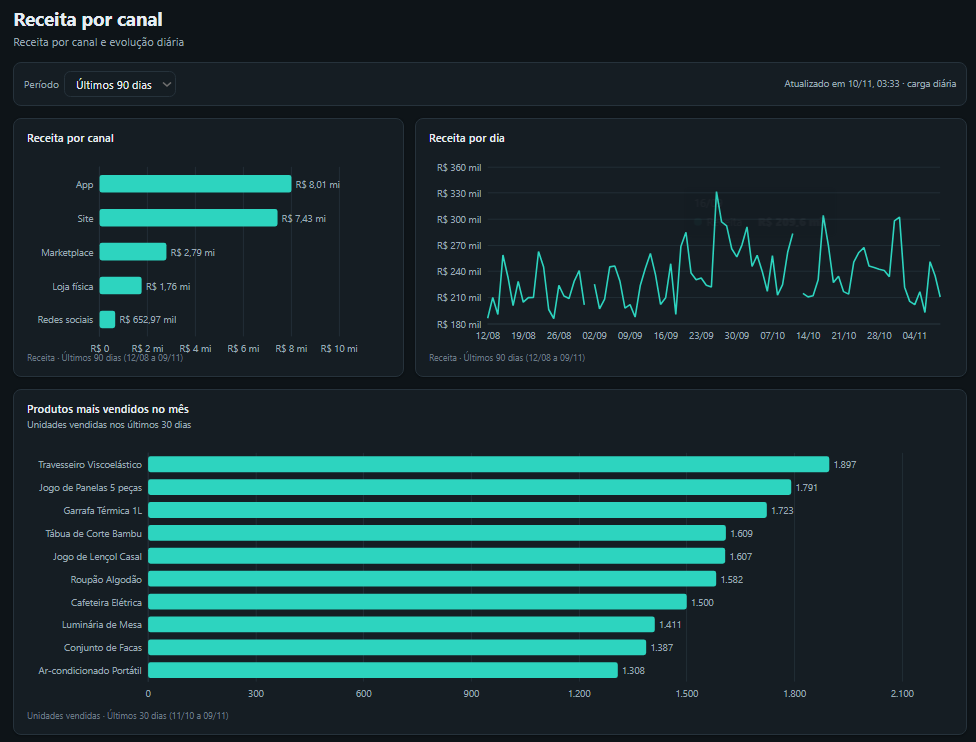
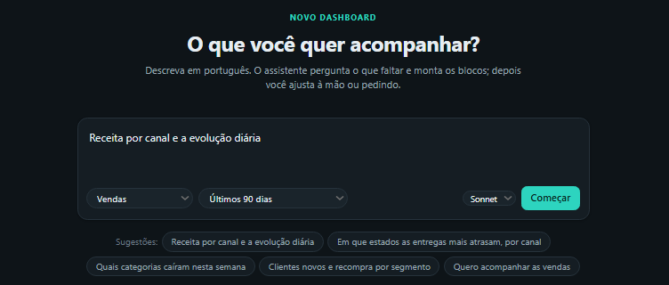
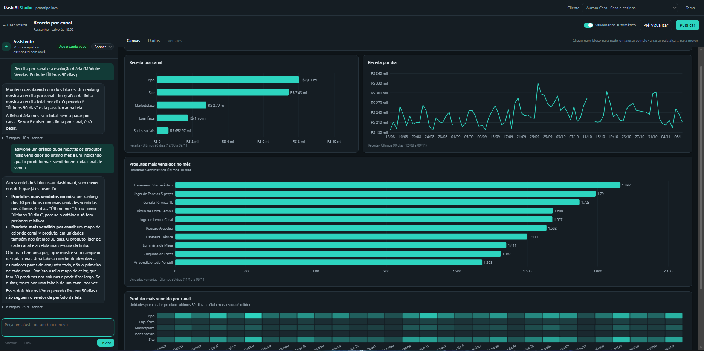

# Dash AI Studio

[](https://github.com/3duzera/dash-ai-studio/actions/workflows/tests.yml)

Este projeto gera **dashboards montados por um agente de IA a partir de um pedido em português, sem deixar a IA perto do banco de dados**.

Você descreve o que quer acompanhar, por exemplo "receita por canal e a evolução diária". Um agente (Claude) escolhe métricas de um **catálogo** e peças de um **kit fechado** e devolve uma **especificação JSON**. Quem transforma essa especificação em SQL, valida e desenha é código determinístico. O agente nunca vê o banco, o SQL nem o dado bruto.

> *English:* AI-built dashboards from natural language. A Claude agent composes a JSON spec from a metric catalog and a closed component kit through MCP tools; a FastAPI layer validates it in four gates and compiles it to parameterized SQL. The model never sees SQL, tables or raw data.

<p align="center">
  
</p>

## A ideia central

**A IA escreve uma especificação, não código nem consulta.** A especificação é uma "receita" do dashboard: quais métricas, quebradas por quais dimensões, em que tipo de gráfico e onde na tela. Isso resolve três problemas de dar a um LLM acesso direto a dados:

| Problema de um agente com acesso ao banco | Como este desenho resolve |
|---|---|
| SQL gerado pode ser errado, lento ou perigoso | O agente não escreve SQL. Cada métrica tem o seu SQL fixo no catálogo, e os filtros entram sempre como parâmetro. |
| Dados de um cliente podem vazar para outro | O tenant é definido por quem chama, nunca pelo modelo. O agente nem sabe qual cliente é. |
| O resultado precisa ser revisado à mão | Toda spec passa por portas de validação automáticas e pelo dry-run com dado real antes de ser salva. |

## Como funciona

```
┌──────────┐   pedido / turno    ┌───────────────────┐   claude -p + MCP   ┌────────┐
│ navegador│ ──────────────────► │ dash-ai (agent/)  │ ──────────────────► │ Claude │
│  (web/)  │ ◄── SSE: progresso  │ monta o contexto, │ ◄── chamadas de     └────────┘
└────┬─────┘                     │ roda e grava      │     ferramenta
     │                           └─────────┬─────────┘          │
     │ blockId + params                    │ sessão (HTTP)      │ ferramentas MCP (HTTP)
     ▼                                     ▼                    ▼
┌──────────────────────────────────────────────────────────────────────┐
│ api (FastAPI): catálogo com SQL, kit, validação, rascunhos, sessão,  │──► Postgres
│ dado de cada bloco                                                   │
└──────────────────────────────────────────────────────────────────────┘
```

| Camada | Sabe | Não sabe |
|---|---|---|
| **api** (FastAPI) | o SQL de cada métrica, o banco, as regras do kit, quem é o cliente | nada de modelo de linguagem |
| **dash-ai** (Node) | como montar o contexto de cada turno, como chamar o modelo, a conversa | SQL, banco, senha |
| **modelo** (Claude) | o catálogo público (ids, descrições, dimensões), o kit, o rascunho atual | SQL, tabelas, outros clientes, qual tenant é |

O agente trabalha só com **ferramentas MCP**: `get_kit`, `get_catalog`, `profile_data`, `validate_spec`, `save_draft`, `get_draft` e, no Studio, `propose_options`. Não existe ferramenta de publicar: quem publica é uma pessoa.

### Exemplo de spec
```json
{
  "title": "Vendas por canal",
  "params": { "state": { "type": "state", "default": ["sp", "rj", "mg"] } },
  "rows": [{ "blocks": [
    { "id": "receita-canal", "kind": "ranking_bar", "span": 6, "title": "Receita por canal",
      "query": { "metric": "revenue", "dimensions": ["channel"], "filters": { "state": "$state" }, "sort": "desc" } },
    { "id": "evolucao", "kind": "line", "span": 6, "title": "Receita por dia",
      "query": { "metric": "revenue", "dimensions": ["day"], "filters": { "state": "$state" } } }
  ]}]
}
```
A query só escolhe métrica, dimensões, filtros, período, ordem e limite. Não há campo de SQL, cor livre, HTML ou URL, e o schema recusa qualquer chave desconhecida.

### As quatro portas de validação
Toda spec passa pelas mesmas portas, venha ela do agente ou de uma edição manual:
1. **Formato:** schema Pydantic com `extra="forbid"`.
2. **Sentido:** a métrica existe e pertence ao módulo do cliente; a dimensão é aceita pela métrica e pela peça; cada linha soma 12 colunas; os filtros existem.
3. **Edição:** com um bloco selecionado, os outros precisam ficar idênticos.
4. **Dry-run:** cada bloco roda com dado real; bloco vazio ou com erro volta como erro.

Cada erro sai como `{blockId, path, message, hint}`, em português, para o agente se corrigir sozinho.

## Studio: construção por conversa

<p align="center">
  
</p>

<p align="center">
  
</p>

No exemplo acima, o primeiro pedido gerou dois blocos. O segundo pedido, escrito às pressas, pedia "o produto mais vendido em cada canal". O kit não tem uma peça para isso, e o assistente explicou a limitação e escolheu um mapa de calor em vez de inventar um componente.

O Studio transforma a geração numa conversa contínua:
- o primeiro pedido abre um rascunho, e o assistente pergunta o que faltar, com opções;
- dá para ajustar o canvas à mão (arrastar, largura, tipo de peça, título) e pelo chat;
- clicar num bloco faz o próximo pedido valer só para ele.

**A memória é do sistema, não do modelo.** Cada turno é uma chamada nova ao modelo. A camada dash-ai monta o contexto com:
- o rascunho atual;
- as edições manuais desde a última resposta;
- as últimas mensagens;
- o bloco selecionado.

Isso garante três coisas:
- o modelo sempre vê a versão real da spec;
- a conversa sobrevive a uma troca de modelo;
- cada turno fica auditável no log `runs/`.

## Resultados

| Verificação | Resultado |
|---|---|
| Testes da API (`pytest`): portas de validação, Studio e dados | **45/45** |
| Evals de uma tacada: 21 pedidos com o resultado esperado (Haiku) | **21/21**, 18 de 19 specs válidas na primeira tentativa |
| Evals do Studio: 3 cenários de sessão (Sonnet e Haiku) | **3/3** nos dois modelos |
| Custo estimado por turno do Studio, se cobrado pela API | ≈ US$ 0,038 (Sonnet) · ≈ US$ 0,002 (Haiku) |

Os evals comparam o Sonnet com o Haiku em qualidade, tempo e custo. Os pedidos incluem armadilhas, como uma métrica que não existe ou um módulo que o cliente não contratou, que o agente precisa recusar ou contornar.

## Como rodar

Pré-requisitos: Docker (com Compose v2) e o [Claude Code](https://docs.claude.com/en/docs/claude-code), usado só para gerar o token.

```bash
claude setup-token                 # gera um token sk-ant-oat01-...
cp .env.example .env               # cole o token em CLAUDE_CODE_OAUTH_TOKEN
docker compose up -d --build       # postgres → seed (dados fictícios) → api → agent
```

Abra **http://localhost:8000**. O botão **Carregar exemplos** traz 3 dashboards prontos, e **+ Novo dashboard** abre o Studio.

Os dados são de duas lojas online fictícias, com 90 dias de pedidos gerados de forma determinística e alguns padrões plantados para os dashboards terem o que mostrar.

| Comando | Para quê |
|---|---|
| `docker compose exec -w /srv api pytest -q` | Testes da API |
| `node evals/run.mjs` | Os 21 pedidos de teste, no Sonnet e no Haiku |
| `node evals/studio.mjs` | Os 3 cenários de sessão do Studio |
| `docker compose logs -f agent` | Ver o agente trabalhando |
| `docker compose down -v` | Desligar e apagar o banco |

No Git Bash do Windows, prefixe `MSYS_NO_PATHCONV=1` nos comandos com caminho.

## Como o agente fica isolado

- As ferramentas nativas do Claude Code (terminal, arquivos, web) ficam desligadas com `--tools ""`. Só as ferramentas MCP ficam liberadas (`--strict-mcp-config` + `--allowedTools`).
- O container do agente está numa rede Docker que alcança a API, mas **não o Postgres**.
- Cliente, sessão e rascunho chegam ao servidor MCP por variável de ambiente, definida por quem chamou.
- O navegador manda só `blockId` + parâmetros. A query sai da spec salva no servidor.

## Estrutura

```
api/app/        FastAPI: catálogo (métricas + SQL), spec (Pydantic), validação, compilador de queries, Studio
api/tests/      45 testes (validação, Studio e os dados plantados)
agent/          camada dash-ai (server.mjs), servidor MCP com as ferramentas e prompts
web/            front sem build: lista, visualização, Studio e os 7 tipos de bloco (ECharts)
db/             schema, migrações e gerador de dados fictícios
evals/          pedidos de teste com o esperado, comparadores e relatórios
specs/exemplos/ 3 dashboards escritos à mão
docs/           arquitetura em detalhe e catálogo de métricas
```

Para mais detalhes, veja [docs/ARQUITETURA.md](docs/ARQUITETURA.md) e [docs/METRICAS.md](docs/METRICAS.md).

## Do protótipo para produção

Este é um protótipo local. Estes atalhos foram tomados de propósito:

| Hoje | Num deploy de verdade |
|---|---|
| `claude -p` com o token da assinatura (uso pessoal) | API do Claude com tool use e chave de API |
| cliente escolhido num seletor (header `X-Tenant`) | tenant da sessão autenticada |
| kit e catálogo lidos por ferramenta a cada turno | kit e catálogo no contexto, com prompt caching |
| sem histórico de versões | versões da spec com desfazer |

A sessão, as ferramentas, a spec e as portas de validação continuam iguais. Só o motor de cada turno muda.

## Autor
**Eduardo Minghini Sales da Silva** · [GitHub](https://github.com/3duzera) · [LinkedIn](https://www.linkedin.com/in/eduardo-minghini-sales-da-silva-84b409205/)

Código sob licença MIT ([`LICENSE`](LICENSE)). Todos os dados do projeto são fictícios.
